  

  &nbsp;
  &nbsp;
  &nbsp;
  

 

**QA Tech Labs** teaches software testing the way real teams practise it. Learners don't just watch slides: they build a real application and a production-style test framework, review code every week, and finish with a project they can show in an interview.

 

| Track | Format | What you walk away with |
|---|---|---|
| 🎭 **Playwright + TypeScript** | 8 weeks · live | TypeScript from scratch to a production-style framework with a CI pipeline |
| 🧪 **Manual Testing Foundations** | 5 weeks · live | SDLC, test design techniques, bug reporting and Agile ways of working |
| 🤖 **AI for QA** | 4 weeks · live | Working with AI models, coding agents and MCP servers in a QA workflow |
| 🔌 **API Testing** | live | REST and GraphQL testing with Postman and REST Assured |
| 🗄️ **Database Testing** | live | SQL, PostgreSQL and MongoDB for testers |
| ⚡ **Performance Testing** | live | Load and performance testing with k6 and JMeter |

> Every session is recorded and uploaded the same day, with lifetime access to recordings, slides and code. Batches run in IST, with slots that also suit Europe and the Middle East. **[See upcoming batches →](https://www.qatechlabs.com/)**

 

**[interview.qatechlabs.com](https://interview.qatechlabs.com/)** helps you walk into your QA interview ready, with 240+ questions organised as ordered study paths from fresher to architect.

| Level | Experience | Focus |
|---|---|---|
| 🌱 Fresher | 0–1 yrs | Testing basics, test design, first SQL, Git and Selenium script |
| 🧭 Junior QA | 1–3 yrs | Locators, waits, TestNG, Page Object Model, Postman, REST |
| 🚀 Mid-level QA | 3–5 yrs | Playwright, REST Assured, data-driven tests, CI, flaky tests |
| 🏗️ Senior SDET | 5–8 yrs | Design patterns, contract tests, performance, test infrastructure |
| 🧠 Lead / Architect | 8+ yrs | Test strategy, architecture, metrics, shift-left, org-wide quality |

**Inside:** 60-second spoken answers with a timer · timed, scored mock interviews · live coding labs that run on GitHub Actions · flashcards and progress tracking.

 

 

<table>
<tr>
<td width="62%" valign="top">

### Karthik Kodati
**Founder, QA Tech Labs · Quality Engineering Architect**

9+ years in quality engineering across enterprise, financial services, the public sector and mobile. Karthik architects the systems that let teams release with confidence, and QA Tech Labs teaches that same approach.

**[karthik.qatechlabs.com →](https://karthik.qatechlabs.com/)**

</td>
<td width="38%" valign="top">

**Selected work**
- 🏢 One tenant-aware Playwright + TypeScript framework covering **4 Workday domains**
- 📡 Kafka event-stream validation for **financial systems** with automated quality gates
- ⏱️ **40% faster** test execution after an automation transformation

**Experience:** Zensar · Mphasis · SMARTnCODE · Exaze · Progment

</td>
</tr>
</table>

 

Hands-on coding labs are live at **[interview.qatechlabs.com](https://interview.qatechlabs.com/)**. Each one runs on GitHub Actions from a repo under your own name, so the work ends up on your profile.

- 🛒 **Interview scenarios:** a shop, an HR portal and a fashion store
- 🧩 **Framework labs:** saucedemo.com, OrangeHRM and AutomationExercise
- 🏗️ **Architect track:** build a test framework from scratch

Public practice repositories will be published here too. **Follow this page** to be notified.
 

  &nbsp;
  &nbsp;
  

For hiring, corporate training or consulting, write to <b>support@qatechlabs.com</b>.

 

